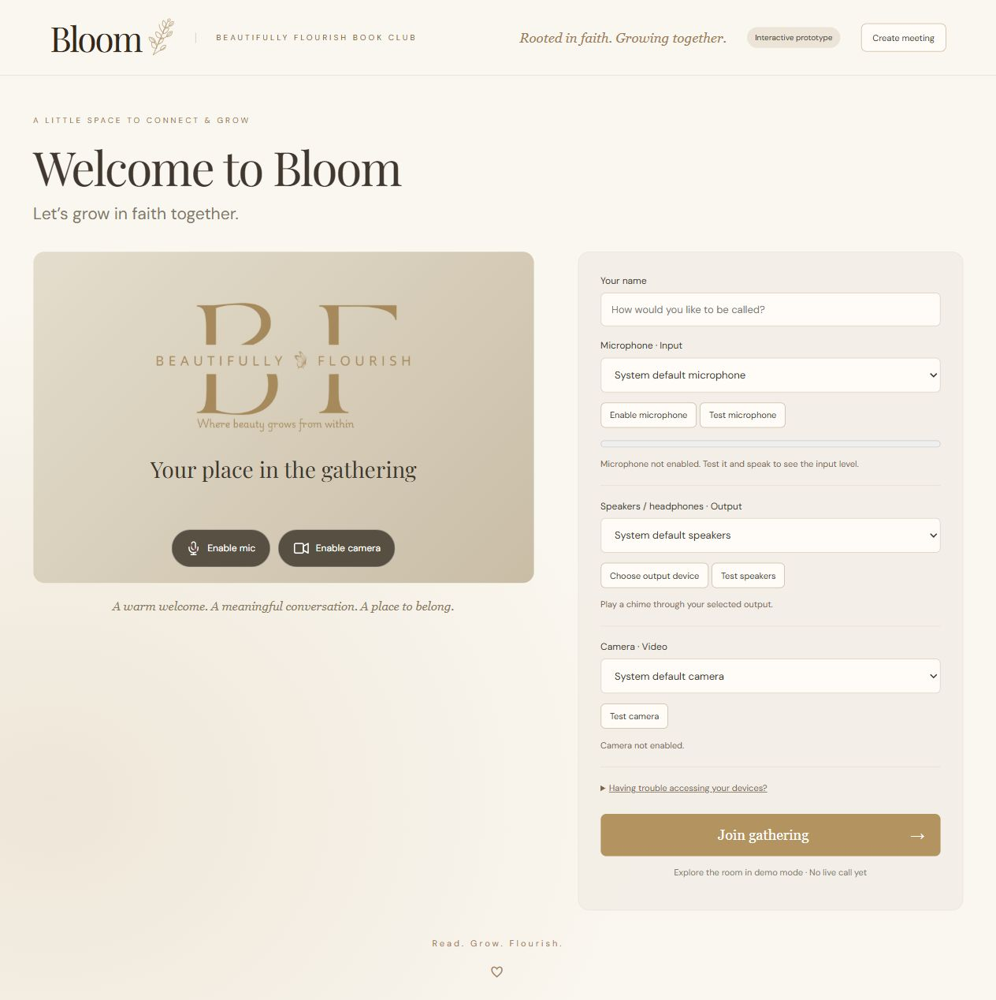
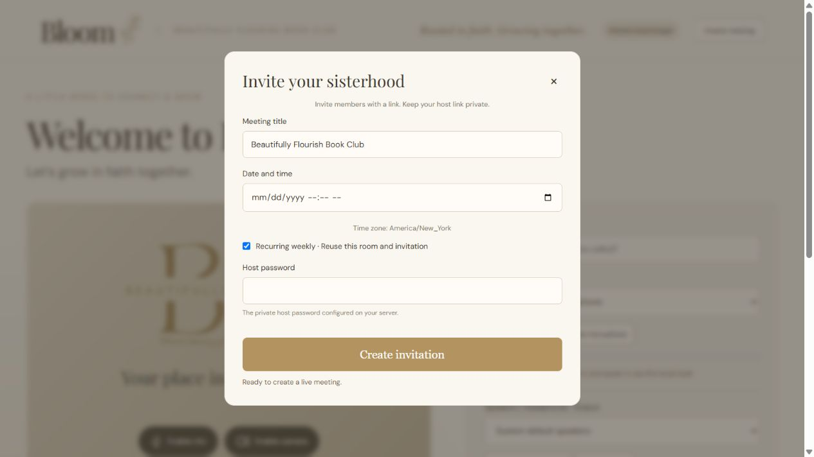
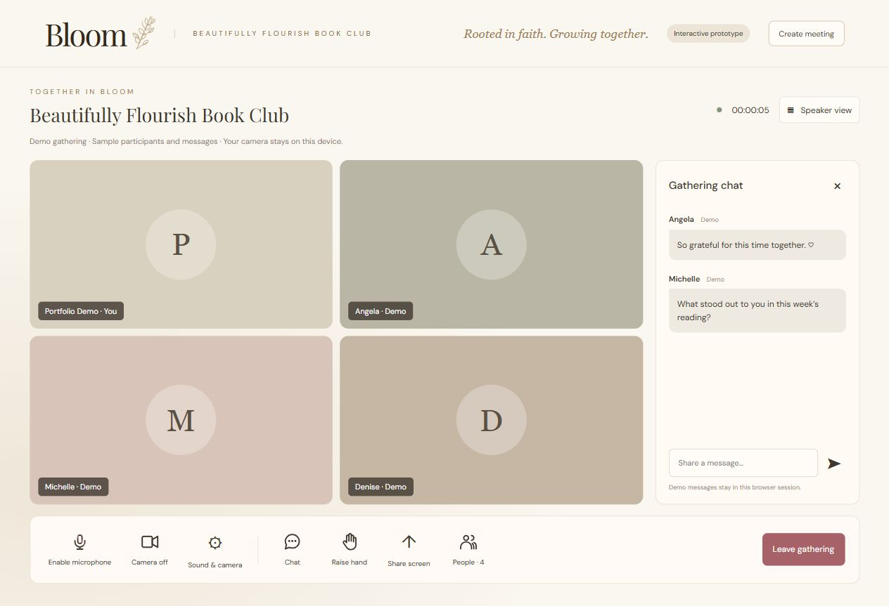
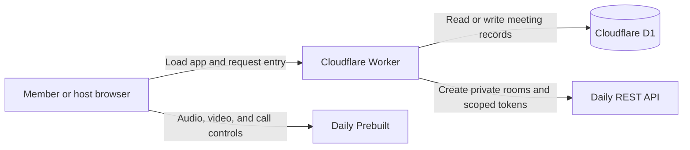

# Bloom

**A branded video-meeting web app for a women’s Christian book club.**

Bloom brings meeting invitations, device checks, host admission, and video calling into a welcoming experience inspired by Beautifully Flourish. It was developed for a weekly group of four members, with room settings configured for growth to 20 participants.

[Open the deployed app](https://bloom-book-club.bloom-book-club.workers.dev/)

The public entrance includes a demonstration room that can be explored without a Daily account or camera access. Real gatherings use a meeting-specific invitation link and Daily’s embedded call interface.



## The problem

The book club needed an approachable place to gather for discussions and prayer, with simple invitations and enough time for a two-hour session. The product direction emphasized a warm visual identity, straightforward device setup, and guest entry using a name and invitation link.

Bloom has no application-enforced meeting-duration cutoff. Video-service usage, account conditions, network quality, and hosting limits still apply.

## What the app does

- Creates meetings with a title, date, time zone, and reusable weekly invitation.
- Generates separate member invitations and private host links.
- Lets guests enter their name and request admission without a meeting password.
- Uses private Daily rooms and host admission to manage entry.
- Separates microphone input, speaker/headphone output, and camera selection.
- Provides a microphone level meter, speaker test chimes, and a camera preview.
- Supports video calling, chat, raise hand, screen sharing, and call layouts through Daily Prebuilt.
- Enables manual cloud recording for hosts, with recording access through the Daily dashboard.
- Stores hosted meeting records in Cloudflare D1.
- Supplies branded Open Graph metadata for shared links.

## Screenshots

### Host invitation form

The host creates a gathering and receives an invitation to share with members. Meeting creation requires the deployment’s host password.



### Interactive demonstration room

This screenshot shows the custom demonstration room with sample participants and messages. Live calls use Daily Prebuilt and have a different toolbar and layout.



Screenshots use sample data and contain no actual member video, private host links, or API credentials.

## How it was built

| Layer | Technology | Responsibility |
| --- | --- | --- |
| Interface | HTML, CSS, vanilla JavaScript | Responsive branding, forms, device checks, invitation UI, and demo room |
| Browser media | MediaDevices, MediaStream, Web Audio APIs | Camera preview, independent microphone capture, input meter, and speaker tests |
| Live video | Daily REST API and pinned Daily JavaScript SDK | Private rooms, host/member tokens, waiting room, embedded calls, and recording controls |
| Hosted API | Cloudflare Workers | Meeting creation, input validation, host authorization, and token issuance |
| Persistent storage | Cloudflare D1 / SQL migrations | Meeting records and request-rate counters |
| Local development | Node.js HTTP server | Static files and equivalent local meeting endpoints |
| Verification | Node.js assertions and VM-based browser stubs | Device isolation, token roles, loader behavior, and API checks |
| Deployment | Wrangler | Worker assets, D1 migrations, and server-side secrets |



Daily supplies the conferencing infrastructure and live-call interface. Bloom supplies the branded entrance, invitation workflow, device testing, authorization checks, and hosting integration.

## Engineering work demonstrated

- **Product scoping and iteration.** The implementation evolved through feedback on mobile spacing, logo treatment, icon clarity, guest passwords, device access, and recording.
- **Browser device integration.** Camera and microphone access are requested independently, allowing one device to work when another is unavailable or denied. The microphone test measures input without feeding it to the speakers.
- **API integration and troubleshooting.** The app handles Daily room creation and token issuance, validates the SDK export, and displays connection errors at the join form. The SDK is version-pinned.
- **Server-side authorization.** A host password protects meeting creation. Private per-meeting host keys determine owner tokens. Guest tokens request waiting-room admission.
- **Persistent backend design.** The deployed Worker uses D1 instead of filesystem state. Database migrations define the schema, and parameterized queries handle stored data.
- **Secret handling.** Daily API credentials and host configuration stay server-side. The public repository excludes environment files, local records, deployment output, and private configuration.

Development used AI-assisted implementation and debugging alongside user-led product requirements, visual review, and hands-on meeting and recording tests.

## Run locally

Use Node.js 22 or newer and npm.

```sh
git clone https://github.com/Lcw900/bloom-book-club.git
cd bloom-book-club
npm ci
npm start
```

Open `http://localhost:5173`. The welcome screen, device tests, and demonstration room can be explored before configuring live meetings.

For live API functionality, copy `.env.example` to `.env` and set your own values.

| Variable | Purpose |
| --- | --- |
| `DAILY_API_KEY` | Server-side access to your Daily account |
| `BLOOM_HOST_PASSWORD` | A private host password of at least 16 characters |
| `BLOOM_PUBLIC_URL` | The public HTTPS origin used by the Node server when generating invitations |
| `PORT` | Local server port, defaulting to 5173 |

The Node server binds to loopback for local development. Its records are stored under `.bloom-data/`. The deployed Cloudflare implementation uses D1 and derives invitation origins from the incoming HTTPS request.

## Deploy your own instance

1. Create your own Daily and Cloudflare accounts.
2. Authenticate with `npx wrangler login`.
3. Create a D1 database with `npx wrangler d1 create bloom-meetings`.
4. Replace the placeholder database ID in `wrangler.jsonc` with your returned ID.
5. Apply migrations with `npx wrangler d1 migrations apply bloom-meetings --remote`.
6. Deploy with `npm run deploy:cloudflare`.
7. Set the `DAILY_API_KEY` and `BLOOM_HOST_PASSWORD` Worker secrets using Wrangler’s secret prompts or the Cloudflare dashboard.
8. Adjust the public preview URLs in `dist/index.html` for your deployment.

The example configuration omits the original account and database identifiers. Provisioning and video usage can incur provider charges. Recording is billed separately by Daily.

## Verification

```sh
npm test
```

The automated checks cover independent device capture, camera-denial isolation, microphone muting, output selection, host/guest authorization, password-free entry, waiting-room token settings, cross-origin rejection, throttling, and Daily SDK initialization. Daily and database access are mocked in the normal test suite.

`check-live-cloudflare.mjs` is an opt-in integration check against the deployed Bloom instance. It requires authorized private configuration, creates a temporary Daily room and D1 record, verifies host/member tokens, and removes those test resources. It does not establish an audio/video call.

Live host/guest entry and cloud recording have also been exercised during user testing. The repository does not claim a formal load test or a two-hour reliability benchmark.

## Current scope

- A weekly invitation reuses a room. Calendar reminders and automatic scheduling are future work.
- Host access currently uses a shared creation password and private meeting links. Account-based host sign-in and host-link recovery are future work.
- Recorded files are accessed through Daily’s dashboard. Bloom has no in-app recording library yet.
- Browser support determines whether a specific speaker output can be selected.
- The demonstration room and live-call UI are separate experiences.

## Project structure

```text
dist/                       Branded interface, media checks, invitation flow, and assets
cloudflare/worker.mjs        Deployed meeting API
cloudflare/migrations/      D1 schema migrations
server.mjs                  Local Node development server
check-*.mjs / check-*.cjs   Focused verification scripts
docs/screenshots/           Application screenshots
wrangler.jsonc              Sanitized deployment configuration
.env.example                Configuration names and setup guidance
```

Beautifully Flourish artwork is included as project branding. Third-party services and libraries retain their respective ownership and terms.
